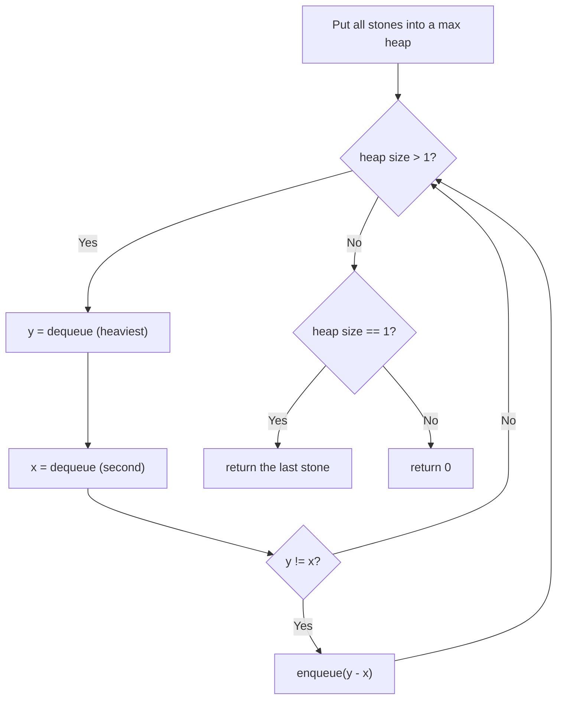

# LeetCode 1046. Last Stone Weight (Easy)

https://leetcode.com/problems/last-stone-weight/

## 覚える範囲

| 解き方 | 区分 | 理由 |
|---|---|---|
| Max Heap（I - Implement） | ✅ 今覚える | 面接で書くのはこれ。「一番大きいものを何度も取り出す」= Heap |
| 毎回 sort（Alternative） | 💬 口で言えればいい | 面接で「最初の案」として話す。書かなくていい |
| Heap の中身を自分で書く | 🔜 後で | まずは使い方だけ。中身は手元の `.ts` の「道具」にある |

Heap の「使い方」で覚えるのは4つだけ。

```
heap.enqueue(x)  … x を入れる
heap.dequeue()   … 一番大きい値を取り出す
heap.front()     … 一番大きい値を見る（取り出さない）
heap.size()      … 入っている数
```

> LeetCode の TypeScript では `MaxPriorityQueue` が最初から使える（import 不要）。`dequeue()` は値をそのまま返す。NeetCode で使えるかは未確認。

## U - Understand（問題の理解）

- **What**: Smash the two heaviest stones again and again. What is left?
- **Input**: An array `stones` of weights
- **Output**: The weight of the last stone (or 0)

**Key insight**: Every turn, we need the **two heaviest** stones.

```
stones = [2, 7, 4, 1, 8, 1]

Turn 1:  8 vs 7  → 8 - 7 = 1 left   [2, 4, 1, 1, 1]
Turn 2:  4 vs 2  → 4 - 2 = 2 left   [2, 1, 1, 1]
Turn 3:  2 vs 1  → 2 - 1 = 1 left   [1, 1, 1]
Turn 4:  1 vs 1  → both gone        [1]
                                     → answer 1
```

- Same weight → both stones are gone.
- Different weight → the smaller one is gone. The bigger one gets lighter.

**Clarifying Questions:**
- "Let me clarify — if no stone is left, do I return 0?" → Yes.
- "Can there be one stone at the start?" → Yes. Return its weight.
- "Can I change the input array?" → Yes. But I will not need to.

**Constraints:**
- 1 <= stones.length <= 30
- 1 <= stones[i] <= 1000

**Test Cases:**

1. **Happy Path**: `[2,7,4,1,8,1]` → `1`
2. **Edge Case (one stone)**: `[1]` → `1`
3. **Edge Case (all gone)**: `[2,2]` → `0`
4. **Edge Case (new stone is the heaviest)**: `[3,7,2]` → `2`
   ```
   7 vs 3 → 4 left   [4, 2]   ← 4 is now the heaviest
   4 vs 2 → 2 left   [2]      → answer 2
   ```
5. **Constraint (max size, all same)**: thirty `1000`s → `0` (they cancel in pairs)

## M - Match（パターンマッチ）

**Pattern: Heap (Priority Queue)**

"We need the biggest value again and again. I think we can use a max heap."

Think of a magic bag. When you put your hand in, you always pull out the **heaviest** stone.

```
     ┌──────────────┐
     │ 2  7  4      │   dequeue() → 8 comes out
     │   1  8  1    │   dequeue() → 7 comes out
     └──────────────┘   enqueue(1) → put 1 back in
```

Why this pattern?
- Each turn needs the two biggest stones.
- After a smash, a new stone goes back in. So the order changes every turn.
- A heap gives the biggest value fast, even after we add new ones.

Show the difference side by side:

| | Sorted array | Heap |
|---|---|---|
| Take the biggest | Fast | Fast (O(log n)) |
| Put a new stone back | Must sort again (O(n log n)) | Fast (O(log n)) |

## P - Plan（プラン立て）

"First, let me think of the simple way. Each turn, I sort the array and take the last two. But I sort again every turn."

"Better: I put all stones into a max heap. Then I take the top two each turn."

**Flowchart:**



**Pseudocode:**
```
// put every stone into a max heap
// while the heap has 2 or more stones:
//   y = take the heaviest
//   x = take the next heaviest
//   if y != x: put (y - x) back
// if one stone is left: return it
// else: return 0
```

## I - Implement（実装）

```typescript
function lastStoneWeight(stones: number[]): number {
  const heap = new MaxPriorityQueue<number>();
  for (const s of stones) heap.enqueue(s);

  while (heap.size() > 1) {
    const y = heap.dequeue()!; // heaviest
    const x = heap.dequeue()!; // second heaviest
    if (y !== x) heap.enqueue(y - x);
  }

  return heap.size() === 1 ? heap.dequeue()! : 0;
}
```

`!` means "this is not null". `dequeue()` can return null when the heap is empty. Here the heap is never empty at that point.

### Alternative: Sort every turn 💬 口で言えればいい

```typescript
function lastStoneWeightSort(stones: number[]): number {
  const arr = [...stones];
  while (arr.length > 1) {
    arr.sort((a, b) => a - b); // small → big
    const y = arr.pop()!; // heaviest
    const x = arr.pop()!; // second heaviest
    if (y !== x) arr.push(y - x);
  }
  return arr.length === 1 ? arr[0] : 0;
}
```

Simple. With n <= 30, this also passes. But it sorts again every turn.

## R - Review（振り返り）

"Let me walk through Test Case 1: `[2,7,4,1,8,1]`."

The heap column shows what is inside, from big to small. (The real order inside a heap is different. Only the top matters.)

| Step | Action | y | x | Heap (big → small) |
|------|--------|---|---|------|
| 0 | enqueue all | | | [8, 7, 4, 2, 1, 1] |
| 1 | dequeue → y | **8** | | [7, 4, 2, 1, 1] |
| 2 | dequeue → x | 8 | **7** | [4, 2, 1, 1] |
| 3 | 8 ≠ 7 → enqueue 1 | | | [4, 2, 1, 1, **1**] |
| 4 | dequeue → y | **4** | | [2, 1, 1, 1] |
| 5 | dequeue → x | 4 | **2** | [1, 1, 1] |
| 6 | 4 ≠ 2 → enqueue 2 | | | [**2**, 1, 1, 1] |
| 7 | dequeue → y | **2** | | [1, 1, 1] |
| 8 | dequeue → x | 2 | **1** | [1, 1] |
| 9 | 2 ≠ 1 → enqueue 1 | | | [1, 1, **1**] |
| 10 | dequeue → y | **1** | | [1, 1] |
| 11 | dequeue → x | 1 | **1** | [1] |
| 12 | 1 = 1 → nothing | | | [1] |
| 13 | size is 1 → return 1 | | | [] |

**Answer: 1** ✓

"Test Case 4: `[3,7,2]`. The new stone becomes the heaviest."

| Step | Action | y | x | Heap (big → small) |
|------|--------|---|---|------|
| 0 | enqueue all | | | [7, 3, 2] |
| 1 | dequeue → y | **7** | | [3, 2] |
| 2 | dequeue → x | 7 | **3** | [2] |
| 3 | 7 ≠ 3 → enqueue 4 | | | [**4**, 2] ← 4 goes to the top |
| 4 | dequeue → y | **4** | | [2] |
| 5 | dequeue → x | 4 | **2** | [] |
| 6 | 4 ≠ 2 → enqueue 2 | | | [**2**] |
| 7 | size is 1 → return 2 | | | [] |

**Answer: 2** ✓ The heap put 4 on top by itself. We did not sort.

"One stone: `[1]`." → size is 1. Skip the loop. Return 1. ✓

"All gone: `[2,2]`." → 2 = 2, nothing goes back. Size is 0. Return 0. ✓

```typescript
console.log(lastStoneWeight([2, 7, 4, 1, 8, 1]) === 1, "Test 1: happy path");
console.log(lastStoneWeight([1]) === 1,                "Test 2: one stone");
console.log(lastStoneWeight([2, 2]) === 0,             "Test 3: all gone");
console.log(lastStoneWeight([3, 7, 2]) === 2,          "Test 4: new stone on top");
console.log(lastStoneWeight(Array(30).fill(1000)) === 0, "Test 5: thirty 1000s");
```

> 検証メモ: 上の5ケースと、ランダムな入力 2,000 個で、Heap 版と sort 版の答えが一致。Heap は LeetCode と同じ `@datastructures-js/priority-queue` 6.4.0 と、手元の `.ts` の道具の両方で確認。

## E - Evaluate（評価）

**Time: O(n log n)** (n = number of stones)
- "Putting n stones in the heap takes O(n log n)."
- "Each turn, at least one stone is gone. So there are at most n turns."
- "Each turn does a few heap steps. Each step is O(log n)."

**Space: O(n)**
- "The heap holds up to n stones."

**Why this approach?**
- Sort every turn: O(n log n) per turn, n turns → O(n² log n).
- Heap: O(log n) per turn, n turns → O(n log n).

**Trade-off:**
| | Sort every turn | Max Heap |
|---|---|---|
| Time | O(n² log n) | O(n log n) |
| Space | O(n) (a copy) | O(n) |
| Code | No library needed | Needs a heap |

"With n <= 30, both pass. But the heap shows I know the right tool for 'get the biggest again and again'."

## VARIATIONS

### A. Heap の中身（🔜 後で）

手元の `LastStoneWeight.ts` の「道具」に、`MaxPriorityQueue` を自分で書いたものがある。面接で「Heap を自分で書いて」と言われたときに読む。

### B. No library: sorted insert

Keep the array sorted. Put each new stone at the right place (with Binary Search). Each turn is O(n) because of the shift. Total O(n²).

## WHEN TO USE WHICH

**Q: When should I think "heap"?**
A: When you need the biggest (or smallest) value **again and again**, and new values keep coming in.

**Q: Max heap or min heap?**
A: Need the biggest → max heap. Need the smallest → min heap.

**Q: Why not sort once?**
A: The new stone `y - x` breaks the order. Sorting once is not enough.

## COMMON INTERVIEW QUESTIONS

**Q: Why not sort once at the start?**
A: "After each smash, a new stone goes back in. It can be bigger than the others. So the order changes."

**Q: Why is the number of turns at most n?**
A: "Each turn takes out two stones and puts back at most one. So the count goes down by at least one."

**Q: Does JavaScript have a heap?**
A: "No, not built in. LeetCode gives MaxPriorityQueue. In an interview, I can ask if I can use one, or write a simple heap."

## RELATED PROBLEMS

- LeetCode 703: Kth Largest Element in a Stream (Easy) — Min heap of size k
- LeetCode 215: Kth Largest Element in an Array (Medium) — Heap
- LeetCode 973: K Closest Points to Origin (Medium) — Heap with a custom order
- LeetCode 621: Task Scheduler (Medium) — Max heap, take the biggest again and again

## HOW TO READ CODE ALOUD

**Code Symbols:**
- `heap.enqueue(s)` → "add s to the heap"
- `heap.dequeue()!` → "take the top of the heap"
- `if (y !== x)` → "if y is not equal to x"
- `heap.size() === 1 ? heap.dequeue()! : 0` → "if the heap has one stone, return it. Otherwise, return zero"

**Complexity:**
- O(n log n) → "O of n log n"
- O(n² log n) → "O of n squared log n"

**Example Explanation Script:**
"Let me walk through stones 2, 7, 4, 1, 8, 1.
I put all of them in a max heap.
The top two are 8 and 7. 8 minus 7 is 1. I put 1 back.
The top two are 4 and 2. 4 minus 2 is 2. I put 2 back.
The top two are 2 and 1. I put 1 back.
The top two are 1 and 1. They are the same, so both are gone.
One stone is left. Its weight is 1."
