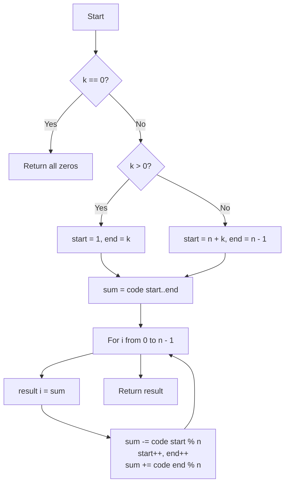

# LeetCode 1652. Defuse the Bomb (Easy)

https://leetcode.com/problems/defuse-the-bomb/

## U - Understand（問題の理解）

- **What**: Replace each number with the sum of its k neighbors
- **Input**: A circular array `code` and a number `k`
- **Output**: A new array of sums

**Key insight**: The array is a circle. After the last item, we go back to the first.

```
code = [5, 7, 1, 4], k = 3

        5
     ↗     ↘
   4         7
     ↖     ↙
        1

i = 0 (5): next 3 → 7 + 1 + 4 = 12
i = 1 (7): next 3 → 1 + 4 + 5 = 10   ← wraps around to 5
```

- `k > 0` → sum of the **next** k numbers (to the right)
- `k < 0` → sum of the **previous** |k| numbers (to the left)
- `k == 0` → 0

**Clarifying Questions:**
- "Let me clarify — do I replace all numbers at the same time?" → Yes. Use the original values.
- "Does the sum include code[i] itself?" → No. Only the neighbors.
- "Can k be bigger than n?" → No. |k| is at most n - 1.
- "Can I return a new array?" → Yes.

**Constraints:**
- 1 <= n <= 100
- 1 <= code[i] <= 100
- -(n - 1) <= k <= n - 1

**Test Cases:**

1. **Happy Path (k > 0)**: `[5,7,1,4], k = 3` → `[12,10,16,13]`
2. **Happy Path (k < 0)**: `[2,4,9,3], k = -2` → `[12,5,6,13]`
3. **Edge Case (k = 0)**: `[1,2,3,4], k = 0` → `[0,0,0,0]`
4. **Edge Case (n = 1)**: `[7], k = 0` → `[0]` (k must be 0 when n = 1)
5. **Constraint (|k| = n - 1)**: `[1,2,3], k = -2` → `[5,4,3]` (every other number)

## M - Match（パターンマッチ）

**Pattern: Fixed-size Sliding Window (on a circle)**

"I think we can use a sliding window of size |k|."

Why this pattern?
- Each answer is the sum of |k| numbers in a row.
- When i moves by 1, the window also moves by 1.
- Only one number leaves and one number enters.
- So we don't need to add up all k numbers again.

```
code = [5, 7, 1, 4], k = 3

i = 0:  window = [7, 1, 4]       sum = 12
i = 1:  window = [1, 4, 5]       sum = 12 - 7 + 5 = 10
                  ↑ 7 leaves, 5 enters
```

**Circle trick**: use `index % n` to wrap around.
- `4 % 4 = 0` → back to the start.

## P - Plan（プラン立て）

"Let me think about the steps."

"First, if k is 0, I return an array of zeros."

"Next, I find the first window for i = 0."
- k > 0: window is `[1, k]` (right after i = 0)
- k < 0: window is `[n + k, n - 1]` (the last |k| numbers)

```
k = 3, n = 4:            k = -2, n = 4:
 [5, 7, 1, 4]             [2, 4, 9, 3]
     └─────┘                     └──┘
   start=1, end=3          start=2, end=3
```

"Then for each i, I save the sum. Then I slide the window by 1."

**Flowchart:**



**Pseudocode:**
```
// if k == 0: return array of zeros
// set start, end for the first window (i = 0)
//   k > 0: start = 1, end = k
//   k < 0: start = n + k, end = n - 1
// sum = code[start] + ... + code[end]
// for i from 0 to n - 1:
//   result[i] = sum
//   remove code[start % n] from sum, start++
//   end++, add code[end % n] to sum
// return result
```

## I - Implement（実装）

```typescript
function decrypt(code: number[], k: number): number[] {
  const n = code.length;
  const result: number[] = new Array(n).fill(0);
  if (k === 0) return result;

  // First window (for i = 0)
  let start = k > 0 ? 1 : n + k;
  let end = k > 0 ? k : n - 1;

  let sum = 0;
  for (let j = start; j <= end; j++) {
    sum += code[j];
  }

  for (let i = 0; i < n; i++) {
    result[i] = sum;

    // Slide the window by 1
    sum -= code[start % n]; // left number leaves
    start++;
    end++;
    sum += code[end % n]; // new right number enters
  }

  return result;
}
```

### Alternative: Brute Force

```typescript
function decryptBrute(code: number[], k: number): number[] {
  const n = code.length;
  const result: number[] = new Array(n).fill(0);

  for (let i = 0; i < n; i++) {
    for (let j = 1; j <= Math.abs(k); j++) {
      // k > 0: go right. k < 0: go left.
      const idx = k > 0 ? (i + j) % n : (i - j + n) % n;
      result[i] += code[idx];
    }
  }

  return result;
}
```

Simple and fine for n <= 100. But it is O(n * k).

## R - Review（振り返り）

"Let me walk through Test Case 1: `code = [5, 7, 1, 4], k = 3`."

First window: start = 1, end = 3, sum = 7 + 1 + 4 = 12

| Step | i | start | end | Action | sum | result |
|------|---|-------|-----|--------|-----|--------|
| 1 | 0 | 1 | 3 | result[0] = 12 | 12 | [**12**,0,0,0] |
| 2 | 0 | 2 | 4 | -code[1]=7, +code[0]=5 | **10** | [12,0,0,0] |
| 3 | 1 | 2 | 4 | result[1] = 10 | 10 | [12,**10**,0,0] |
| 4 | 1 | 3 | 5 | -code[2]=1, +code[1]=7 | **16** | [12,10,0,0] |
| 5 | 2 | 3 | 5 | result[2] = 16 | 16 | [12,10,**16**,0] |
| 6 | 2 | 4 | 6 | -code[3]=4, +code[2]=1 | **13** | [12,10,16,0] |
| 7 | 3 | 4 | 6 | result[3] = 13 | 13 | [12,10,16,**13**] |

**Answer: [12, 10, 16, 13]** ✓

"Let me check the negative case: `code = [2, 4, 9, 3], k = -2`."

First window: start = 4 + (-2) = 2, end = 3, sum = 9 + 3 = 12

| Step | i | start | end | Action | sum | result |
|------|---|-------|-----|--------|-----|--------|
| 1 | 0 | 2 | 3 | result[0] = 12 | 12 | [**12**,0,0,0] |
| 2 | 0 | 3 | 4 | -code[2]=9, +code[0]=2 | **5** | [12,0,0,0] |
| 3 | 1 | 3 | 4 | result[1] = 5 | 5 | [12,**5**,0,0] |
| 4 | 1 | 4 | 5 | -code[3]=3, +code[1]=4 | **6** | [12,5,0,0] |
| 5 | 2 | 4 | 5 | result[2] = 6 | 6 | [12,5,**6**,0] |
| 6 | 2 | 5 | 6 | -code[0]=2, +code[2]=9 | **13** | [12,5,6,0] |
| 7 | 3 | 5 | 6 | result[3] = 13 | 13 | [12,5,6,**13**] |

**Answer: [12, 5, 6, 13]** ✓

"k = 0: `[1, 2, 3, 4]`." → return zeros right away. ✓

"n = 1: `[7], k = 0`." → k must be 0. Return `[0]`. ✓

```typescript
const eq = (a: number[], b: number[]) => JSON.stringify(a) === JSON.stringify(b);
console.log(eq(decrypt([5, 7, 1, 4], 3), [12, 10, 16, 13]), "Test 1: k > 0");
console.log(eq(decrypt([2, 4, 9, 3], -2), [12, 5, 6, 13]),  "Test 2: k < 0");
console.log(eq(decrypt([1, 2, 3, 4], 0), [0, 0, 0, 0]),     "Test 3: k = 0");
console.log(eq(decrypt([7], 0), [0]),                         "Test 4: n = 1");
console.log(eq(decrypt([1, 2, 3], -2), [5, 4, 3]),           "Test 5: k = -(n-1)");
console.log(eq(decrypt([1, 2, 3], 2), [5, 4, 3]),            "Test 6: k = n-1");
```

## E - Evaluate（評価）

**Time: O(n)**
- "The first window takes |k| steps. The main loop takes n steps. |k| < n, so it is O(n)."

**Space: O(1)** (not counting the output)
- "I only use start, end, and sum."

**Why this approach?**
- Brute force adds k numbers for every i — O(n * k).
- Sliding window reuses the last sum. One out, one in.

**Trade-off:**
| | Brute Force | Sliding Window |
|---|---|---|
| Time | O(n * k) | O(n) |
| Space | O(1) | O(1) |
| Code | Very simple | A bit more setup |

"With n <= 100, brute force is also OK. But sliding window shows I know the pattern."

## VARIATIONS

### A. Prefix Sum on a doubled array

Copy the array twice: `[5,7,1,4,5,7,1,4]`. Then any window is a normal range. Use prefix sums to get each range sum in O(1). Time O(n), space O(n).

### B. Fixed window on a normal (not circular) array

Same idea without `% n`. Example: "Maximum Average Subarray I" (LeetCode 643).

## WHEN TO USE WHICH

**Q: When should I think "fixed-size sliding window"?**
A: When every answer is the sum of k items in a row, and i moves by 1 each time.

**Q: How do I handle a circular array?**
A: Use `index % n`. Or copy the array twice (`[...code, ...code]`).

## COMMON INTERVIEW QUESTIONS

**Q: Why do you use the original values, not the new ones?**
A: "The problem says replace all numbers at the same time. So I write to a new array."

**Q: How do you handle k < 0 without extra code?**
A: "I only change where the first window starts. The slide step is the same for both."

**Q: Why is `n + k` the start for k < 0?**
A: "For i = 0, the previous |k| numbers are the last |k| numbers. They start at n - |k|, which is n + k."

## RELATED PROBLEMS

- LeetCode 643: Maximum Average Subarray I (Easy) — Fixed-size window
- LeetCode 1343: Number of Sub-arrays of Size K and Average >= Threshold (Medium) — Fixed-size window
- LeetCode 503: Next Greater Element II (Medium) — Circular array with `% n`
- LeetCode 2134: Minimum Swaps to Group All 1's Together II (Medium) — Circular sliding window

## HOW TO READ CODE ALOUD

**Code Symbols:**
- `code[end % n]` → "code at end mod n"
- `start = k > 0 ? 1 : n + k` → "if k is positive, start is one. Otherwise, start is n plus k"
- `sum -= code[start % n]` → "subtract code at start mod n from sum"

**Complexity:**
- O(n) → "O of n" or "linear time"
- O(n * k) → "O of n times k"

**Example Explanation Script:**
"Let me walk through code [5, 7, 1, 4] with k equals 3.
For i equals 0, the window is 7, 1, 4. The sum is 12.
Now I slide the window. 7 leaves and 5 enters. 12 minus 7 plus 5 is 10.
Next, 1 leaves and 7 enters. 10 minus 1 plus 7 is 16.
Next, 4 leaves and 1 enters. 16 minus 4 plus 1 is 13.
So the answer is 12, 10, 16, 13."
