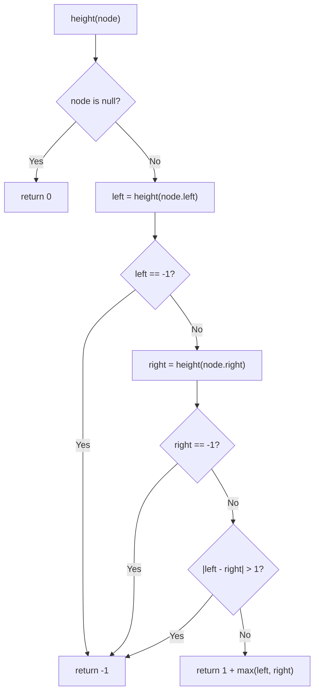

# LeetCode 110. Balanced Binary Tree (Easy)

https://leetcode.com/problems/balanced-binary-tree/

## 覚える範囲

| 解き方 | 区分 | 理由 |
|---|---|---|
| Bottom-up DFS（I - Implement） | ✅ 今覚える | 面接で書くのはこれ。104 Max Depth のコードに3行足すだけ |
| Brute Force（Alternative） | 💬 口で言えればいい | 面接で「最初の案」として話す。書かなくていい |

104 Max Depth と同じ「Recursive DFS：子に聞いて組み立てる」型。違いは、高さと一緒に「壊れていないか」も返すこと。

## U - Understand（問題の理解）

- **What**: Check if the tree is "balanced"
- **Input**: The `root` of a binary tree
- **Output**: `true` or `false`

**Key insight**: Balanced means: at **every** node, the left height and the right height differ by **1 or less**.

```
        3          node 3:  left = 1, right = 2  → diff 1 ✓
       / \         node 20: left = 1, right = 1  → diff 0 ✓
      9   20       others:  no children          → diff 0 ✓
         /  \
        15   7     → true
```

```
          1        node 1: left = 3, right = 1  → diff 2 ✗
         / \
        2   2      → false
       / \
      3   3
     / \
    4   4
```

**Clarifying Questions:**
- "Let me clarify — do I check only the root, or every node?" → Every node.
- "What is the height of an empty tree?" → 0. (Same as Max Depth.)
- "Is an empty tree balanced?" → Yes.
- "Is the difference 1 OK?" → Yes. Only 2 or more is not balanced.

**Constraints:**
- 0 <= number of nodes <= 5000
- -10^4 <= Node.val <= 10^4

**Test Cases:**

1. **Happy Path (true)**: `[3,9,20,null,null,15,7]` → `true`
2. **Happy Path (false)**: `[1,2,2,3,3,null,null,4,4]` → `false`
3. **Edge Case (empty)**: `[]` → `true`
4. **Edge Case (one node)**: `[1]` → `true`
5. **Edge Case (the trap)**: `[1,2,2,3,null,null,3,4,null,null,4]` → `false`
   ```
           1          root: left = 3, right = 3 → diff 0 ✓  (looks OK!)
          / \
         2   2        left 2: left = 2, right = 0 → diff 2 ✗
        /     \
       3       3
      /         \
     4           4
   ```
   Checking only the root gives the wrong answer. We must check every node.
6. **Constraint (a long line)**: 5000 nodes, all on the left → `false`

## M - Match（パターンマッチ）

**Pattern: Tree DFS (Recursion), bottom-up**

"This looks like Max Depth. I need the height of each side at every node."

Think of a factory line. Each worker checks their part and passes up a report.

```
            1   "Left says 3, right says 1. Diff is 2. BROKEN."
           / \
  "I'm 3" 2   2  "I'm 1"
         / \
        3   3
```

- Each node asks its left and right child: "How tall are you?"
- If a child says "BROKEN", pass "BROKEN" up right away.
- If the two heights differ by 2 or more, say "BROKEN".
- Else, say "I'm 1 + the bigger height."

**How do we say "BROKEN" with a number?**
A height is never negative. So we use **-1** to mean "broken".

```
height = 0, 1, 2, 3, ...   → normal
height = -1                → this part is not balanced
```

Why this pattern?
- The answer for a node comes from its two children. → Recursion.
- We need heights from the bottom first. → Bottom-up (children first, then the node).

## P - Plan（プラン立て）

"First, let me think of the simple way."

"For each node, I compute the left height and right height with Max Depth. Then I check the children the same way. But this counts the same nodes again and again."

"Better: I compute the height and check balance **in one pass**. I return -1 if a part is not balanced."

**Flowchart:**



**Pseudocode:**
```
// isBalanced(root): return height(root) is not -1
//
// height(node):
//   if node is null: return 0
//   left = height(node.left)
//   if left is -1: return -1          ← broken below, stop
//   right = height(node.right)
//   if right is -1: return -1         ← broken below, stop
//   if |left - right| > 1: return -1  ← broken here
//   return 1 + max(left, right)       ← same as Max Depth
```

**Compare with Max Depth (104):**

```
maxDepth(node):                     height(node):
  if null: return 0                   if null: return 0
  left  = maxDepth(left)              left  = height(left)
                                      if left is -1: return -1      ← new
  right = maxDepth(right)             right = height(right)
                                      if right is -1: return -1     ← new
                                      if |left - right| > 1: return -1  ← new
  return 1 + max(left, right)         return 1 + max(left, right)
```

## I - Implement（実装）

```typescript
function isBalanced(root: TreeNode | null): boolean {
  return height(root) !== -1;
}

// Returns the height. Returns -1 if not balanced.
function height(node: TreeNode | null): number {
  if (node === null) return 0;

  const left = height(node.left);
  if (left === -1) return -1; // broken below

  const right = height(node.right);
  if (right === -1) return -1; // broken below

  if (Math.abs(left - right) > 1) return -1; // broken here

  return 1 + Math.max(left, right);
}
```

### Alternative: Brute Force 💬 口で言えればいい

```typescript
function isBalancedBrute(root: TreeNode | null): boolean {
  if (root === null) return true;

  const diff = Math.abs(maxDepth(root.left) - maxDepth(root.right));
  if (diff > 1) return false;

  return isBalancedBrute(root.left) && isBalancedBrute(root.right);
}
```

Easy to think of. But `maxDepth` counts the same nodes many times.

```
         1
       /   \
      2     3          maxDepth from node 1 → counts 4, 5, 6, 7
     / \   / \         maxDepth from node 2 → counts 4, 5 again
    4   5 6   7        maxDepth from node 3 → counts 6, 7 again
```

## R - Review（振り返り）

"Let me walk through Test Case 2: `[1,2,2,3,3,null,null,4,4]`."

```
          1
         / \
        2   2
       / \
      3   3
     / \
    4   4
```

Children come first. So the bottom nodes finish first.

| Step | Node | left | right | diff | return |
|------|------|------|-------|------|--------|
| 1 | 4 (bottom left) | 0 | 0 | 0 | **1** |
| 2 | 4 (bottom right) | 0 | 0 | 0 | **1** |
| 3 | 3 (left) | 1 | 1 | 0 | **2** |
| 4 | 3 (right) | 0 | 0 | 0 | **1** |
| 5 | 2 (left) | 2 | 1 | 1 | **3** |
| 6 | 2 (right) | 0 | 0 | 0 | **1** |
| 7 | 1 (root) | 3 | 1 | **2** | **-1** |

`height(root)` is -1 → **false** ✓

"Let me check Test Case 1: `[3,9,20,null,null,15,7]`."

| Step | Node | left | right | diff | return |
|------|------|------|-------|------|--------|
| 1 | 9 | 0 | 0 | 0 | **1** |
| 2 | 15 | 0 | 0 | 0 | **1** |
| 3 | 7 | 0 | 0 | 0 | **1** |
| 4 | 20 | 1 | 1 | 0 | **2** |
| 5 | 3 (root) | 1 | 2 | 1 | **3** |

`height(root)` is 3, not -1 → **true** ✓

"Now the trap, Test Case 5: `[1,2,2,3,null,null,3,4,null,null,4]`."

| Step | Node | left | right | diff | return |
|------|------|------|-------|------|--------|
| 1 | 4 (left side) | 0 | 0 | 0 | **1** |
| 2 | 3 (left side) | 1 | 0 | 1 | **2** |
| 3 | 2 (left side) | 2 | 0 | **2** | **-1** |
| 4 | 1 (root) | **-1** | — | — | **-1** (stop. No need to check the right side.) |

→ **false** ✓ The -1 goes up right away. We never visit the right side.

"Empty tree: `[]`." → height is 0, not -1 → `true` ✓

"One node: `[1]`." → left 0, right 0, diff 0 → height 1 → `true` ✓

```typescript
console.log(isBalanced(buildTree([3, 9, 20, null, null, 15, 7])) === true,             "Test 1: true");
console.log(isBalanced(buildTree([1, 2, 2, 3, 3, null, null, 4, 4])) === false,        "Test 2: false");
console.log(isBalanced(buildTree([])) === true,                                        "Test 3: empty");
console.log(isBalanced(buildTree([1])) === true,                                       "Test 4: one node");
console.log(isBalanced(buildTree([1, 2, 2, 3, null, null, 3, 4, null, null, 4])) === false, "Test 5: trap");
```

> 検証メモ: 上の5ケースに `[1,null,2]`（true）と `[1,null,2,null,3]`（false）を加えた7ケースで、Bottom-up 版・Brute Force 版とも期待どおり。左に一直線の 5000 ノードの木も、手元の Node v24.6.0 で両方 `false` を返す（スタックはあふれない）。

## E - Evaluate（評価）

**Time: O(n)**
- "I visit each node once. Each visit does O(1) work."
- If a part is broken, I stop early. So it can be even faster.

**Space: O(h)** (h = height of the tree)
- "The call stack holds one call per level."
- Balanced tree: O(log n). Worst case (a line): O(n).
- A line is not balanced. But we still go to the bottom first, because children come first.

**Why this approach?**
- Brute force counts heights again and again.
- Bottom-up gets the height and the check in one pass.

**Trade-off:**
| | Brute Force | Bottom-up DFS |
|---|---|---|
| Time | O(n log n) if balanced, O(n²) as a safe upper bound | O(n) |
| Space | O(h) | O(h) |
| Code | Uses Max Depth as is | Max Depth + 3 lines |
| Idea | Top-down: check, then go down | Bottom-up: go down, then check |

"Brute force is the first idea. But the same nodes are counted many times. So I return the height and the balance together, in one pass."

## VARIATIONS

### A. Return two values instead of -1

Return `[isBalanced, height]` as a pair. Same idea, but clearer for some people.

```typescript
function check(node: TreeNode | null): [boolean, number] {
  if (node === null) return [true, 0];
  const [lb, lh] = check(node.left);
  const [rb, rh] = check(node.right);
  const ok = lb && rb && Math.abs(lh - rh) <= 1;
  return [ok, 1 + Math.max(lh, rh)];
}
```

No early stop here. It always visits every node. Still O(n).

## WHEN TO USE WHICH

**Q: When should I think "bottom-up DFS"?**
A: When a node needs answers from both children first. Height, balance, and diameter are good examples.

**Q: Why use -1?**
A: A height is never negative. So -1 cannot be mixed up with a real height. It lets one number carry two answers.

## COMMON INTERVIEW QUESTIONS

**Q: Why can't you only check the root?**
A: "A tree can look OK at the root but be broken inside." (Show Test Case 5.)

**Q: Why is brute force slow?**
A: "It calls Max Depth at every node. So the same nodes are counted many times."

**Q: Why do you stop when you see -1?**
A: "If one part is broken, the whole tree is broken. So I don't need to check the rest."

## RELATED PROBLEMS

- LeetCode 104: Maximum Depth of Binary Tree (Easy) — The base of this problem
- LeetCode 543: Diameter of Binary Tree (Easy) — Also uses height of each side, plus one more answer
- LeetCode 111: Minimum Depth of Binary Tree (Easy) — Height with a twist
- LeetCode 100: Same Tree (Easy) — Recursion on two trees

## HOW TO READ CODE ALOUD

**Code Symbols:**
- `height(root) !== -1` → "height of root is not minus one"
- `Math.abs(left - right) > 1` → "the absolute value of left minus right is greater than one"
- `if (left === -1) return -1` → "if left is minus one, return minus one"

**Complexity:**
- O(n) → "O of n" or "linear time"
- O(h) → "O of h, where h is the height of the tree"
- O(n²) → "O of n squared"

**Example Explanation Script:**
"Let me walk through the tree 1, 2, 2, 3, 3, null, null, 4, 4.
The two 4s have no children. They return 1.
The left 3 gets 1 and 1. It returns 2. The right 3 returns 1.
The left 2 gets 2 and 1. The difference is 1, so it is OK. It returns 3.
The right 2 returns 1.
The root gets 3 and 1. The difference is 2. So it returns minus one.
The tree is not balanced."
