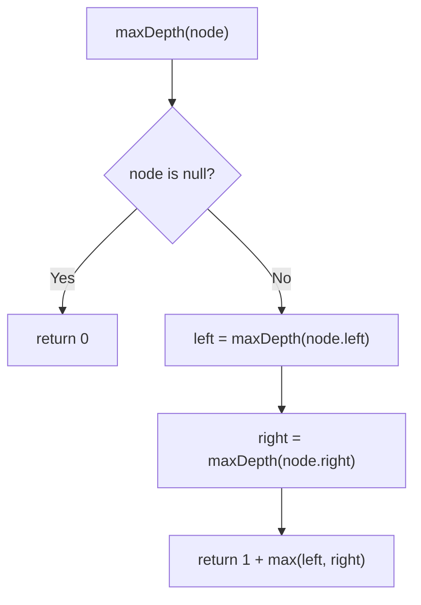
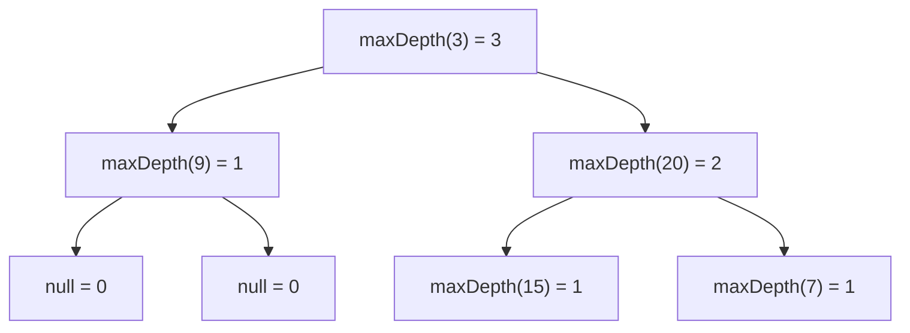

# LeetCode 104. Maximum Depth of Binary Tree (Easy)

https://leetcode.com/problems/maximum-depth-of-binary-tree/

## 覚える範囲

| 解き方 | 区分 | 理由 |
|---|---|---|
| Recursive DFS（I - Implement） | ✅ 今覚える | 面接で書くのはこれ。4行 |
| BFS（Alternative） | 🔜 後で | LeetCode 102 Level Order で必ず使う型。その時に覚える |
| Iterative DFS with a stack（VARIATIONS A） | ❌ 不要 | Recursive DFS と同じことを長く書いただけ |

木の問題はほとんどが2つの型で解ける。

| 型 | 主な問題 | 覚える順 |
|---|---|---|
| Recursive DFS「子に聞いて組み立てる」 | 104 Max Depth, 226 Invert Tree, 100 Same Tree, 543 Diameter, 110 Balanced Tree | 1番目 |
| BFS「1段ずつ見る」 | 102 Level Order, 199 Right Side View, 111 Min Depth | 2番目 |

## U - Understand（問題の理解）

- **What**: Find how many levels the tree has
- **Input**: The `root` of a binary tree
- **Output**: A number (the max depth)

**Key insight**: Depth = the number of **nodes** on the longest path from the root to a leaf.

```
        3        ← level 1
       / \
      9   20     ← level 2
         /  \
        15   7   ← level 3

Longest path: 3 → 20 → 15  (3 nodes)  → answer = 3
Short path:   3 → 9        (2 nodes)
```

**Clarifying Questions:**
- "Let me clarify — do we count nodes or edges?" → Nodes. One node means depth 1.
- "What if the tree is empty?" → Return 0.
- "Is the tree balanced?" → Not always. It can be one long line.
- "Can I change the tree?" → No need. We only read it.

**Constraints:**
- 0 <= number of nodes <= 10^4
- -100 <= Node.val <= 100

**Test Cases:**

1. **Happy Path**: `[3,9,20,null,null,15,7]` → `3`
2. **Edge Case (empty)**: `[]` → `0`
3. **Edge Case (one node)**: `[1]` → `1`
4. **Edge Case (one side only)**: `[1,null,2]` → `2`
5. **Constraint (a long line)**: 10^4 nodes, all on the left → `10000` (the recursion goes 10^4 calls deep. It can overflow the stack.)

## M - Match（パターンマッチ）

**Pattern: Tree DFS (Recursion)**

"I think we can use recursion. The answer for a tree comes from the answers for its two children."

Think of a company. The boss asks two managers: "How deep is your team?"

```
            3   "My depth = 1 + the bigger answer"
           / \
   "I'm 1" 9   20  "I'm 2"
              /  \
     "I'm 1" 15    7 "I'm 1"
```

- Each node asks its left and right child.
- It takes the bigger answer and adds 1 (for itself).
- An empty spot (`null`) says "0".

Why this pattern?
- A tree is made of smaller trees. The same question works for every node.
- Tree problems that say "max / min / height / path" often use DFS.

Another option: **BFS (level by level)**. Count how many levels we visit. See the Alternative below.

## P - Plan（プラン立て）

"Let me think about the two parts of a recursion."

"First, the base case. If the node is null, the depth is 0."

"Next, the recursive case. I get the depth of the left tree and the right tree. Then I return 1 plus the bigger one."

**Flowchart:**



**Call order (Example 1):**



**Pseudocode:**
```
// if node is null: return 0
// left  = depth of left tree
// right = depth of right tree
// return 1 + max(left, right)
```

## I - Implement（実装）

```typescript
function maxDepth(root: TreeNode | null): number {
  // Base case: empty tree
  if (root === null) return 0;

  const left = maxDepth(root.left);
  const right = maxDepth(root.right);

  // +1 for this node
  return 1 + Math.max(left, right);
}
```

### Alternative: BFS (level by level) 🔜 後で

```typescript
function maxDepthBFS(root: TreeNode | null): number {
  if (root === null) return 0;

  let queue: TreeNode[] = [root];
  let depth = 0;

  while (queue.length > 0) {
    depth++; // we are on a new level
    const next: TreeNode[] = [];
    for (const node of queue) {
      if (node.left) next.push(node.left);
      if (node.right) next.push(node.right);
    }
    queue = next;
  }

  return depth;
}
```

No recursion, so no deep call stack. Good for a very long, thin tree.

## R - Review（振り返り）

"Let me walk through Test Case 1: `[3,9,20,null,null,15,7]`."

| Step | Call | Action | Return |
|------|------|--------|--------|
| 1 | maxDepth(3) | go left | |
| 2 | maxDepth(9) | go left | |
| 3 | maxDepth(null) | base case | **0** |
| 4 | maxDepth(9) | go right | |
| 5 | maxDepth(null) | base case | **0** |
| 6 | maxDepth(9) | 1 + max(0, 0) | **1** |
| 7 | maxDepth(3) | go right | |
| 8 | maxDepth(20) | go left | |
| 9 | maxDepth(15) | both children null → 1 + max(0, 0) | **1** |
| 10 | maxDepth(20) | go right | |
| 11 | maxDepth(7) | both children null → 1 + max(0, 0) | **1** |
| 12 | maxDepth(20) | 1 + max(1, 1) | **2** |
| 13 | maxDepth(3) | 1 + max(1, 2) | **3** |

**Answer: 3** ✓

"Empty tree: `[]`." → root is null. Return 0 right away. ✓

"One node: `[1]`." → left = 0, right = 0. Return 1 + 0 = 1. ✓

"One side only: `[1,null,2]`."

| Step | Call | Action | Return |
|------|------|--------|--------|
| 1 | maxDepth(1) | go left | |
| 2 | maxDepth(null) | base case | **0** |
| 3 | maxDepth(1) | go right | |
| 4 | maxDepth(2) | both children null → 1 + max(0, 0) | **1** |
| 5 | maxDepth(1) | 1 + max(0, 1) | **2** |

**Answer: 2** ✓ (We must take the **max**. If we only went left, we would get 1.)

```typescript
console.log(maxDepth(buildTree([3, 9, 20, null, null, 15, 7])) === 3, "Test 1: happy path");
console.log(maxDepth(buildTree([])) === 0,                            "Test 2: empty");
console.log(maxDepth(buildTree([1])) === 1,                           "Test 3: one node");
console.log(maxDepth(buildTree([1, null, 2])) === 2,                  "Test 4: one side");
```

## E - Evaluate（評価）

**Time: O(n)**
- "I visit each node once. n is the number of nodes."

**Space: O(h)** (h = height of the tree)
- "The call stack holds one call per level."
- Balanced tree: h = log n → O(log n)
- One long line: h = n → O(n)

```
Balanced (h = 3)        Line (h = 4)
      1                 1
     / \                 \
    2   3                 2
   / \                     \
  4   5                     3
                             \
                              4
```

**Why this approach?**
- The code is 3 lines. It is easy to explain and hard to get wrong.
- It shows I know the basic tree recursion pattern.

**Trade-off:**
| | DFS (Recursion) | BFS (Queue) |
|---|---|---|
| Time | O(n) | O(n) |
| Space | O(h) call stack (worst O(n): a line) | O(w) queue, w = widest level (worst O(n): a full tree) |
| Code | Very short | A bit longer |
| Risk | Stack overflow on a very deep tree | No stack risk |

"Recursion passes on LeetCode. But on my local Node, a line of about 8,000 nodes already overflows the stack. If the tree can be very deep, I would use BFS."

> 検証メモ: Node v24.6.0 のデフォルト設定で、片側一直線の木は 5,000 段は通り、8,000 段で `Maximum call stack size exceeded`。BFS / stack 版は 10,000 段でも 10000 を返す。

## VARIATIONS

### A. Iterative DFS with a stack ❌ 不要

Push `[node, depth]` pairs onto a stack. Keep the biggest depth you see. Same as recursion, but no call stack.

```typescript
function maxDepthStack(root: TreeNode | null): number {
  if (root === null) return 0;
  const stack: [TreeNode, number][] = [[root, 1]];
  let best = 0;
  while (stack.length > 0) {
    const [node, depth] = stack.pop()!;
    best = Math.max(best, depth);
    if (node.left) stack.push([node.left, depth + 1]);
    if (node.right) stack.push([node.right, depth + 1]);
  }
  return best;
}
```

### B. Minimum Depth (LeetCode 111)

Looks the same, but has a trap. A node with only one child is **not** a leaf.

```
  1        maxDepth = 2
   \       minDepth = 2 (not 1!)
    2      the left null is not a leaf
```

## WHEN TO USE WHICH

**Q: DFS or BFS for tree depth?**
A: Both are O(n). DFS is shorter. BFS is better when the tree may be very deep, or when you can stop early (like min depth).

**Q: How do I know a tree problem fits recursion?**
A: Ask: "Can I get the answer for this node from the answers of its children?" If yes, use recursion.

## COMMON INTERVIEW QUESTIONS

**Q: Why do you return 0 for null, not 1?**
A: "An empty tree has no nodes. So its depth is 0. Then a leaf gets 1 + max(0, 0) = 1."

**Q: What is the space complexity?**
A: "O(h), the height of the tree. It is O(log n) if balanced. It is O(n) in the worst case."

**Q: Can this cause a stack overflow?**
A: "Yes, if the tree is very deep. Then I would use BFS or a stack."

## RELATED PROBLEMS

- LeetCode 111: Minimum Depth of Binary Tree (Easy) — Watch the one-child case
- LeetCode 226: Invert Binary Tree (Easy) — Same recursion shape
- LeetCode 110: Balanced Binary Tree (Easy) — Uses height of each side
- LeetCode 543: Diameter of Binary Tree (Easy) — left depth + right depth
- LeetCode 102: Binary Tree Level Order Traversal (Medium) — BFS by level

## HOW TO READ CODE ALOUD

**Code Symbols:**
- `if (root === null) return 0` → "if root is null, return zero"
- `maxDepth(root.left)` → "max depth of root dot left"
- `1 + Math.max(left, right)` → "one plus the max of left and right"

**Complexity:**
- O(n) → "O of n" or "linear time"
- O(h) → "O of h, where h is the height of the tree"
- O(log n) → "O of log n"

**Example Explanation Script:**
"Let me walk through the tree 3, 9, 20, 15, 7.
Node 9 has no children. Both sides return 0, so 9 returns 1.
Node 15 and node 7 also return 1.
Node 20 gets 1 and 1. It returns 1 plus 1, which is 2.
The root 3 gets 1 from the left and 2 from the right.
It returns 1 plus 2, which is 3. So the max depth is 3."
